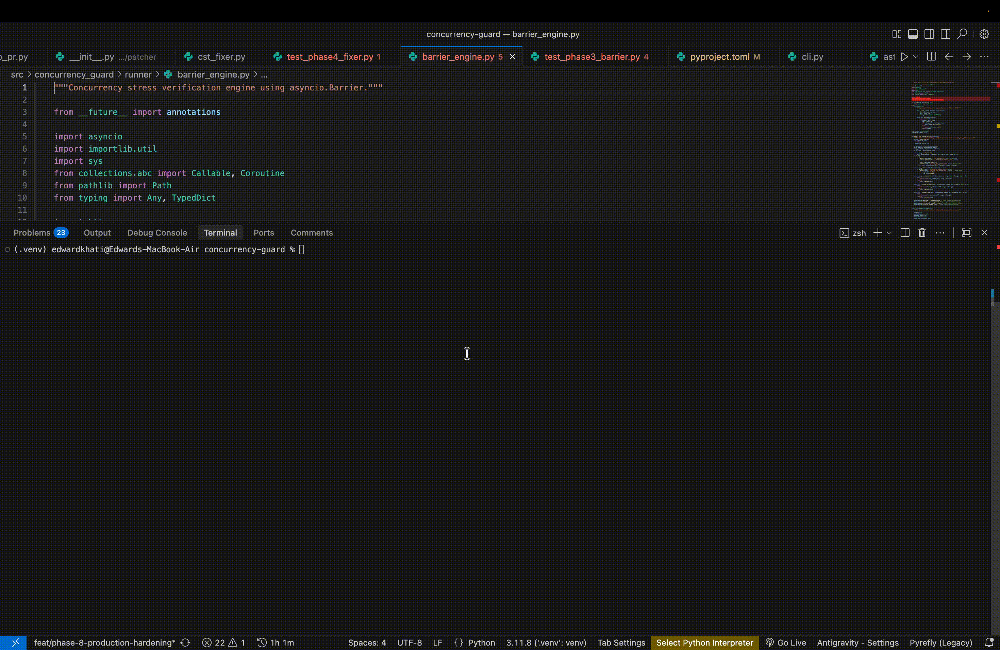

<div align="center">

# ConcurrencyGuard

**Find race conditions and deadlocks in Python.**

[](https://pypi.org/project/concurrency-guard/)
[](https://github.com/AyushkhatiDev/concurrency-guard/actions/workflows/ci.yml)
[](./LICENSE)

[Quick start](#quick-start) · [What it catches](#what-it-catches) · [CI and reports](#ci-and-reports) · [Interactive examples](https://concurrencyguard.dev)



</div>

ConcurrencyGuard (`cguard`) scans Python code for concurrency bugs that can be hard to spot in review. It reports the file, line, and rule ID, and suggests what to change. The static scan reads your source without running it.

## Quick start

```sh
python -m pip install concurrency-guard
cguard scan .
```

Scan a single file by passing its path instead of `.`. To see what an available automatic fix would change, run `cguard fix . --diff`. Apply the changes with `cguard fix . --write`.

ConcurrencyGuard supports Python 3.9 and newer. Run `cguard --version` to check which release your terminal is using. Version 4.1.0 improves recovery from malformed editor requests, adds the cancellation fix to editor code actions, and makes cache cleanup safer.

### Example

Two requests can read the same wallet balance, each subtract an amount, and then overwrite each other’s update:

```python
async def withdraw(session, wallet_id, amount):
    wallet = await session.get(Wallet, wallet_id)
    wallet.balance -= amount
    await session.commit()
```

`cguard scan` reports **CG-001** at the database read. Depending on the database and transaction, a row lock or an atomic SQL update can protect the operation.

## What it catches

| Area | Example findings |
| --- | --- |
| Database writes | Missing row locks, incomplete locking across branches, and check-then-insert races |
| Deadlocks | Functions in different files acquire the same locks in opposite orders |
| Async Python | Shared state changes across an `await`, blocking calls in coroutines, and orphaned tasks |
| Redis and background jobs | Non-atomic check-then-set operations, unsafe lock release, and retry or transaction hazards |

The scanner includes checks for SQLAlchemy, SQLModel, Django ORM, Tortoise ORM, asyncio, Redis, and Celery.

**New in 3.9.0:** CG-028 finds branch paths that can mutate and commit without the lock held on another path. CG-029 traces cross-file lock-order cycles to their acquisition sites. CG-030 detects when a coroutine reads shared module or class state, awaits, and then writes to it without continuous lock protection.

```sh
cguard scan . --select CG-028,CG-029,CG-030
```

## CI and reports

```sh
# Export findings for GitHub Code Scanning
cguard scan . --format sarif --output cguard.sarif

# Open an HTML audit report in your browser
cguard report . --format html --output cguard-report.html
```

The scan exits with status 1 when it reports findings. For a GitHub Actions setup, see the [example Code Scanning workflow](./examples/github-code-scanning.yml). To scan only files changed against a Git base branch, use `cguard scan . --base-ref origin/main`.

Version 3.9.1 improves self-scan accuracy. Deadlock checks resolve local functions and methods by their receiver and class. Redis checks distinguish Redis operations from generic file-cache calls and match the receiver and key.

When scanning this repository, `examples/` and `tests/` include intentional unsafe code used to demonstrate and verify findings. Run `cguard scan src/` to audit the scanner implementation.

Version 3.9.2 recognizes simple repeated database status assignments in retryable tasks and keeps retry warnings when `acks_late=True` is the only safeguard. Arithmetic writes, inserts, state-dependent transitions, and unknown side-effect calls retain their diagnostics.

## More commands

| Command | When to use it |
| --- | --- |
| `cguard verify --help` | Run a concurrency stress test against supported targets |
| `cguard simulate --help` | Explore a possible execution order behind a finding |
| `cguard baseline --help` | Track existing findings so CI can focus on new ones |
| `cguard watch --help` | Rescan while you edit |
| `cguard lsp --help` | Set up editor diagnostics |

Run `cguard --help` for the full command list.

## Contributing

```sh
python -m pip install -e ".[dev]"
pytest
ruff check .
mypy --strict .
```

Browse the [example projects](./examples), [open an issue](https://github.com/AyushkhatiDev/concurrency-guard/issues), or review the [release history on PyPI](https://pypi.org/project/concurrency-guard/#history).

## Async checks in v4.0.0

| Rule | What to review | CWE |
| --- | --- | --- |
| CG-031 | Multiple coroutines in `asyncio.gather` or a `TaskGroup` use one async database session. Give each task its own session. | CWE-362 |
| CG-032 | An async lock is acquired again inside its own context, directly or by an awaited helper. | CWE-833 |
| CG-033 | A bare or `BaseException` handler can swallow cancellation. Re-raise `asyncio.CancelledError` before the broad handler. | CWE-662 |

Preview the cancellation fix with `cguard fix . --rule CG-033 --diff`.

### Scan changes and their callers

Run `cguard scan . --diff-base origin/main` to check committed Python changes since the merge base and the files that transitively import them. Fetch the base ref in CI before scanning. The scanner builds the import graph before running rules on the selected files.

### Add a local rule

Declare workspace-relative Python files in `pyproject.toml`.

```toml
[tool.cguard]
plugins = ["rules/my_rule.py"]
```

Export a `PLUGIN` instance implementing `CGuardRulePlugin` from `cguard.plugins`. Provide a unique uppercase `rule_id`, a `severity` of `HIGH`, `MEDIUM`, or `LOW`, a `cwe` such as `CWE-362`, and a `check(module)` method returning `ASTFinding` values with the same rule ID. The `ParsedModule` gives the rule the file path, source text, and parsed AST.

Run `cguard scan . --allow-plugins` for projects whose Python plugins you trust. Plugins run as Python code with the scanner process's permissions.
