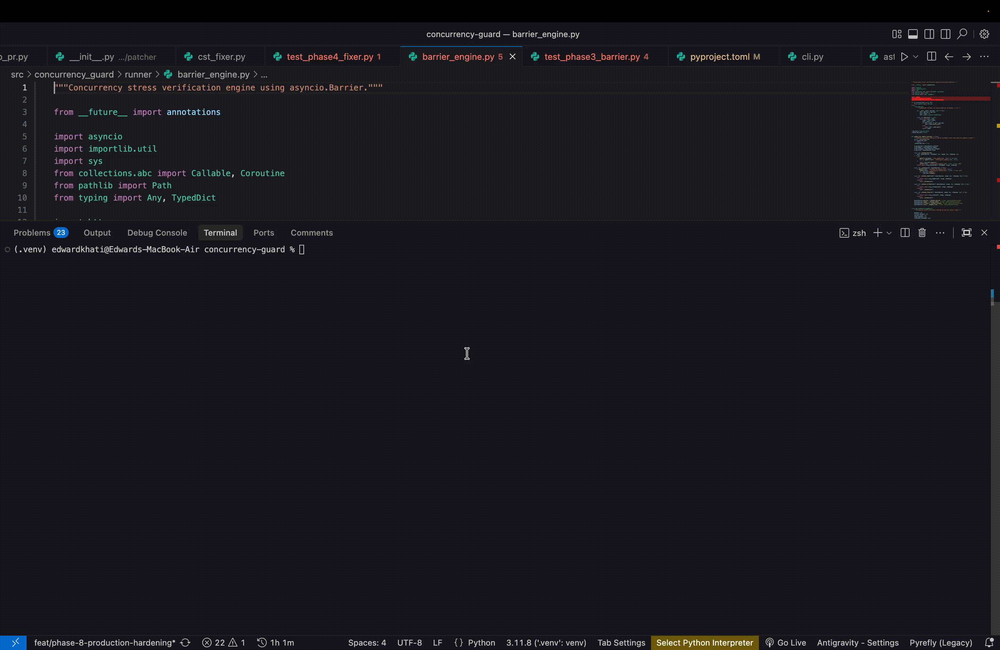
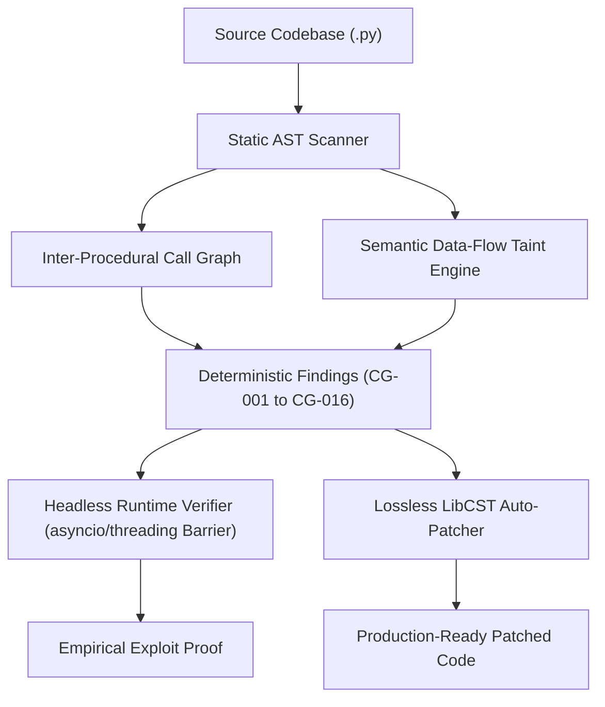

# ConcurrencyGuard (`cguard`)

[](https://pypi.org/project/concurrency-guard/)
[](https://www.python.org/downloads/)
[](https://opensource.org/licenses/MIT)
[](https://github.com/AyushkhatiDev/concurrency-guard)

**v2.1.0 — Enterprise-Grade Semantic SAST Platform & Headless Runtime Race Verifier for Python.**

Natively securing **FastAPI**, **Django ORM**, **SQLAlchemy**, **Celery**, **Redis**, **asyncio**, and multi-threaded Python systems.



---

## The Problem vs. The `cguard` Solution

Traditional code security tools are fundamentally blind to concurrency. Syntax linters only check stylistic conventions, while generic SAST tools search for string-based regex patterns. Large Language Model (LLM) reviewers are non-deterministic, suffer from token context fragmentation, fail to trace cross-file data flow, and cannot mathematically execute code.

`concurrency-guard` (`cguard`) is a **zero-cost, deterministic, 100% offline Semantic SAST platform**. It combines inter-procedural AST call-graph traversal and semantic data-flow taint analysis with an empirical runtime stress engine to catch, prove, and patch race conditions in milliseconds.

| Vulnerability Vector | Linters (Ruff, Flake8) | AI / LLM Reviewers | `cguard` Semantic SAST |
|:---|:---|:---|:---|
| **SQLAlchemy Unlocked RMW** (`CG-001`) | ❌ Blind to DB semantics | ⚠️ Hallucinates, misses context | ✅ **Deterministic AST detection** |
| **Django ORM Unlocked RMW** (`CG-016`) | ❌ Ignored | ⚠️ Misses ORM transaction scope | ✅ **AST `select_for_update` audit** |
| **Missing Idempotency Headers** (`CG-002`) | ❌ Ignored | ⚠️ High latency, non-deterministic | ✅ **Sub-millisecond AST verification** |
| **Async Loop N+1 Explode** (`CG-003`) | ❌ Unchecked | ⚠️ Inconsistent pattern matching | ✅ **Local control-flow AST traversal** |
| **Check-Then-Act Uniqueness Races** (`CG-004`) | ❌ Ignored | ⚠️ Frequently missed | ✅ **Catch-integrity validation** |
| **Celery Retry Duplication** (`CG-005`) | ❌ Ignored | ⚠️ Misses task retry mechanics | ✅ **Decorator & kwarg audit** |
| **Async & Threaded State Mutation** (`CG-006`, `CG-007`) | ❌ Ignored | ⚠️ Fails on non-local globals | ✅ **Context-manager lock analysis** |
| **File I/O & Tempfile Races** (`CG-009`, `CG-010`) | ❌ Ignored | ⚠️ Ignores multi-worker I/O | ✅ **Filesystem concurrency analysis** |
| **Redis / Cache Check-Then-Act** (`CG-011`, `CG-012`) | ❌ Ignored | ⚠️ Recommends fragile locks | ✅ **Atomic primitive audit (SET NX)** |
| **Lock-Order Deadlocks** (`CG-013`) | ❌ Ignored | ❌ Incapable of graph analysis | ✅ **Bipartite lock hierarchy audit** |
| **Cross-File Inter-Procedural Races** (`CG-014`) | ❌ Single-file only | ❌ Exceeds token context window | ✅ **Project-wide Call-Graph engine** |
| **Abstracted Tainted Shared State** (`CG-015`) | ❌ Ignored | ⚠️ Hallucinates variable scope | ✅ **Semantic data-flow taint tracking** |
| **Empirical Exploit Verification** | ❌ None | ❌ Cannot execute code | ✅ **`Barrier` stress engine (HTTP & Headless)** |
| **Deterministic Code Remediation** | ⚠️ Style fixes only | ⚠️ Introduces syntax regressions | ✅ **Zero-regression `LibCST` patcher** |

---

## Why `cguard`? The Architectural Difference

`concurrency-guard` does not use naive regexes or brittle token searches. It parses and analyzes Python code using four enterprise-grade architectural pillars:



### 1. Inter-Procedural Call Graph Analysis (`CG-014`)
Real-world concurrency bugs rarely live in a single 10-line function. A web route often delegates to a service layer, which delegates to a repository layer, which mutates a module-level dictionary or shared cache. `cguard` constructs a project-wide call graph, resolving imported aliases and module symbols across your entire repository. If an endpoint or async worker triggers an unguarded mutation anywhere down the call chain, `cguard` flags the exact path without executing a single line of application code.

### 2. Data-Flow Semantic Taint Tracking (`CG-015`)
When shared state (globals, class-level caches, Redis connections, or singleton pools) is passed across variable assignments, aliased through local dictionaries, or unpacked into parameters, simple AST pattern matchers lose track. `cguard` employs a forward data-flow taint tracker that labels mutable shared references at their origin and propagates taint through assignments, attribute lookups, and function calls. An issue is raised if a tainted reference reaches an unguarded mutation sink (`AugAssign`, `.append()`, `.pop()`, `.set()`, `.update()`).

### 3. Deep Alias & Control Flow Tracking
v2.2.0 follows proven object aliases across assignments such as `wallet → w`, while keeping transaction and row-lock state scoped to the exact lexical control-flow path. A Django read-modify-write is only treated as protected when `select_for_update()` is held inside the same `transaction.atomic()` scope; ambiguous branches, dynamic dispatch, and unsupported data flow intentionally produce no finding or automatic patch.

### 4. Headless Runtime Stress Verification (`cguard verify --headless`)
Static analysis identifies potential hazards; `cguard`'s verification engine mathematically proves them. You no longer need a running web server or live database. `cguard verify` dynamically imports raw Python callables, initializes synchronized barriers (`asyncio.Barrier` for coroutines or `threading.Barrier` for OS threads), and releases up to 100 concurrent workers at the exact same microsecond. By comparing the observed post-execution state against mathematical expectations, it confirms race conditions (such as balance double-spends or lost updates) with zero false alarms.

### 5. Lossless `LibCST` Auto-Patching (`cguard fix --write`)
Fixing security bugs by hand introduces syntax errors and disrupts formatting. `cguard` uses Concrete Syntax Tree (`libcst`) manipulation to safely modify code in place. It injects required locks (`.with_for_update()`, Django `select_for_update()`, `asyncio.Lock`, `threading.Lock`, or `filelock.FileLock`), wraps vulnerable mutations in synchronization contexts, and adds error guards while **100% preserving your comments, docstrings, indentation, and formatting**.

---

## Installation

```bash
pip install concurrency-guard
```

*Requires Python 3.10+ (analyzes and patches Python 3.9+ codebases).*

---

## Quick Start

### 1. Scan your codebase
Run deterministic static analysis across a single file or an entire multi-package repository in milliseconds:

```bash
# Scan a specific file
cguard scan app/routers/wallet.py

# Scan an entire repository (auto-excludes .venv, migrations, and build caches)
cguard scan src/

# Output structured JSON for CI/CD pipelines
cguard scan src/ --format json
```

### 2. Verify race conditions empirically
Prove vulnerabilities at runtime using synchronized barrier stress-testing.

#### Option A: FastAPI & SQLAlchemy Endpoint Verification
```bash
cguard verify examples/vulnerable_wallet.py --workers 20
```

```text
❌ CONCURRENCY INVARIANT VIOLATED (RACE PROVEN)
Target Endpoint: POST /wallet/withdraw
Concurrent Barrier Workers: 20
Initial Balance: $50
Successful Withdrawals ($50 each): 20
Final Resulting Balance: $-950 (Double-spend exploit confirmed!)
```

#### Option B: Headless Function Verification (No HTTP / No Framework)
Stress-test any raw Python async function or thread target directly in memory:

```bash
cguard verify worker.py --headless --function update_shared_state --workers 50
```

```text
❌ HEADLESS CONCURRENCY INVARIANT VIOLATED
Target Function: worker.py::update_shared_state
Synchronization Engine: asyncio.Barrier (50 workers)
Expected Increments: 50
Observed State Value: 14 (Lost 36 state updates due to unguarded RMW race!)
```

### 3. Automatically patch vulnerabilities in-place
Review changes with a dry-run diff, or write deterministic fixes directly to disk:

```bash
# Preview the unified diff (dry-run)
cguard fix app/routers/wallet.py

# Apply fixes directly to files
cguard fix app/routers/wallet.py --write
```

---

## Supported Vulnerability Rules

`concurrency-guard` comes out of the box with 16 enterprise-grade security rules covering web frameworks, ORMs, asynchronous concurrency, multi-threading, and distributed tasks:

| Rule ID | Vulnerability Vector | Framework / Subsystem | Trigger Condition | Automated Remediation (`LibCST`) |
|:---|:---|:---|:---|:---|
| **`CG-001`** | **Unlocked Read-Modify-Write Race** | SQLAlchemy / FastAPI | Route reads state (`select`, `db.scalar`, `session.get`), mutates an attribute, and commits without row locking. | Appends `.with_for_update()` to query chain. |
| **`CG-002`** | **Missing Idempotency Guard on POST** | FastAPI / Web APIs | Mutating `@app.post` / `@router.post` performs DB writes without an `Idempotency-Key` header. | Injects `Idempotency-Key` header parameter into route signature. |
| **`CG-003`** | **Async Loop N+1 Query Explode** | SQLAlchemy 2.0 / AsyncIO | Queries (`.execute()`, `.scalar()`, `.get()`) executed directly inside a `for` or `async for` loop body. | Flags query explosion; suggests eager loading (`selectinload`). |
| **`CG-004`** | **Check-Then-Act Uniqueness Race** | SQLAlchemy / Databases | Query checks record existence, calls `db.add()`, and commits without handling `IntegrityError`. | Wraps commit in `try...except IntegrityError` with rollback. |
| **`CG-005`** | **Non-Idempotent Celery Retry Task** | Celery / Distributed Queues | Retrying Celery task executes database commits or external POST calls without `acks_late=True` or deduplication lock. | Recommends `acks_late=True` and distributed idempotency lock. |
| **`CG-006`** | **Async Shared-State Mutation** | `asyncio` Standard Library | Coroutine mutates module-level collection (`list`, `dict`, `set`) without an `asyncio.Lock` context. | Injects `asyncio.Lock()` and wraps mutation in `async with`. |
| **`CG-007`** | **Threaded Collection Mutation** | `threading` Standard Library | Multi-threaded target modifies shared built-in state without a `threading.Lock` / `RLock`. | Injects `threading.Lock()` and wraps mutation in `with lock:`. |
| **`CG-008`** | **Generic Read-Modify-Write Race** | Core Python Memory | Subscript or attribute read into local variable, transformed, and reassigned without synchronization. | Recommends atomic operation or lock-guarded block. |
| **`CG-009`** | **Concurrent File Write Race** | Filesystem / File I/O | Concurrent writes via `open()` or `aiofiles.open()` in write/append mode without a file lock. | Wraps file context in `filelock.FileLock`. |
| **`CG-010`** | **Insecure Shared Tempfile Race** | Filesystem Security | Hard-coded or predictable path used under `/tmp` across concurrent execution contexts. | Recommends task-isolated `tempfile.NamedTemporaryFile`. |
| **`CG-011`** | **Cache Check-Then-Act Race** | Redis / Memcached | Cache key read (`get()`) followed by conditional write (`set()`) without atomic primitives. | Recommends Redis `SET key value NX` or Lua scripting. |
| **`CG-012`** | **Non-Atomic Cache Invalidation** | Distributed Caching | Database write committed before or after cache deletion without transactional synchronization. | Recommends two-phase cache invalidation or atomic write-through. |
| **`CG-013`** | **Lock-Order Inversion Deadlock** | Concurrency Primitives | Multiple locks acquired in opposing hierarchical order across functions or modules. | Identifies cycle and establishes strict global acquisition order. |
| **`CG-014`** | **Inter-Procedural Call-Chain Race** | Cross-Module Architecture | Local route or worker calls an imported function whose transitive call-chain mutates shared state without a lock. | Traces full cross-file call graph to the mutation sink. |
| **`CG-015`** | **Tainted Shared-State Mutation** | Semantic Data Flow | Mutable reference to global/singleton/cache state passes through aliases or args into an unguarded mutation. | Traces taint propagation and isolates unprotected mutation sink. |
| **`CG-016`** | **Django ORM Unlocked RMW Race** | Django ORM | Django query (`objects.get()`, `filter().first()`) mutated and saved without `select_for_update()`. | Injects `.select_for_update()` inside `transaction.atomic()`. |

---

## Custom Rules (YAML DSL)

Define bespoke concurrency and state-management policies for proprietary internal clients, distributed caches, or company microservices without writing code.

Create a `concurrency-rules.yml` file:

```yaml
rules:
  - id: ACME-001
    description: "Acme wallet balance updates must acquire the tenant lock"
    function: "acme_wallet.deduct"
    modifies: "wallet.balance"
    without_context: "tenant_lock"
    message: "Tenant balance mutation must be protected with `async with tenant_lock:`"
    fix: "Wrap balance deduction in `async with tenant_lock:`"

  - id: ACME-002
    description: "Internal Redis credit allocation must use Lua scripts"
    call: "redis_client.set"
    variable: "user_credits"
    without_lock: "redis_dist_lock"
    message: "Direct credit set detected. Use atomic Lua script or acquire `redis_dist_lock`."
```

Scan using your custom rules:

```bash
cguard scan src/ --rules concurrency-rules.yml
```

---

## CI/CD Pipeline Integration

Enforce zero concurrency vulnerabilities on every pull request using the official GitHub Action or CLI reporter:

### GitHub Actions (`.github/workflows/cguard.yml`)

```yaml
name: Concurrency Security Scan

on:
  pull_request:
    branches: [main]
  push:
    branches: [main]

jobs:
  cguard-audit:
    runs-on: ubuntu-latest
    steps:
      - uses: actions/checkout@v4

      - name: Set up Python
        uses: actions/setup-python@v5
        with:
          python-version: "3.11"

      - name: Install dependencies
        run: pip install concurrency-guard

      - name: Run ConcurrencyGuard Scan
        run: cguard scan src/

      - name: Generate PR Markdown Report
        if: failure()
        run: cguard report src/ >> $GITHUB_STEP_SUMMARY
```

---

## Source and Releases

Source code, issue tracking, and roadmap are maintained at:  
👉 **[github.com/AyushkhatiDev/concurrency-guard](https://github.com/AyushkhatiDev/concurrency-guard)**

---

## License

Distributed under the **MIT License**. See [LICENSE](LICENSE) for details.
